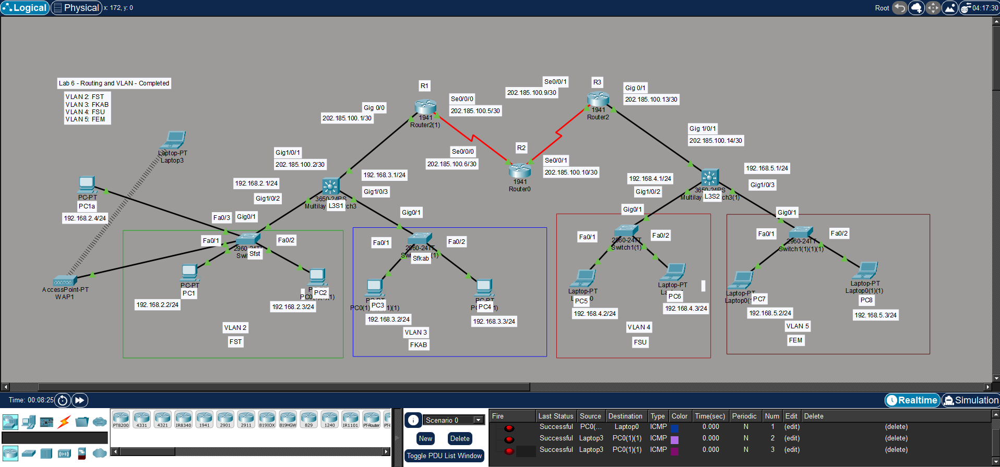

# Routing and VLAN Network Design

A Cisco Packet Tracer lab that implements VLAN segmentation across four faculties, with inter-VLAN routing using Layer 3 switches and static routing between routers.

## Features

- Network segmentation using 4 VLANs (one per faculty)
- Inter-VLAN routing using two Layer 3 switches (3650-24PS)
- Point-to-point links between routers using /30 subnets
- Wireless access using an Access Point and Laptop
- Connectivity testing between all VLANs

## VLANs

| VLAN | Faculty | Subnet | Gateway |
|------|---------|--------|---------|
| 2 | FST | 192.168.2.0/24 | 192.168.2.1 |
| 3 | FKAB | 192.168.3.0/24 | 192.168.3.1 |
| 4 | FSU | 192.168.4.0/24 | 192.168.4.1 |
| 5 | FEM | 192.168.5.0/24 | 192.168.5.1 |

## Router Links

| Link | Network |
|------|---------|
| L3S1 - R1 | 202.185.100.0/30 |
| R1 - R2 | 202.185.100.4/30 |
| R2 - R3 | 202.185.100.8/30 |
| R3 - L3S2 | 202.185.100.12/30 |

## Network Topology

## Technologies Used

- Cisco Packet Tracer
- VLANs & Trunking (802.1Q)
- Inter-VLAN Routing (Layer 3 Switch)
- Static Routing
- IP Addressing & Subnetting (/24 and /30)
- Wireless (Access Point)

## How to Run

1. Download `Routing_and_VLAN.pkt`
2. Open Cisco Packet Tracer
3. Open the file and wait for the network to load
4. Use `ping` from any PC to test connectivity between VLANs

## Useful Commands

- `show vlan brief`
- `show ip route`
- `show running-config`
